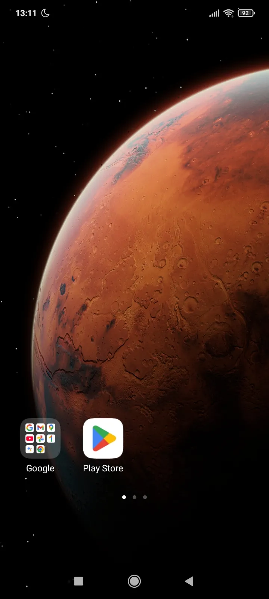

# Login dan verifikasi email

Panduan ini menjelaskan cara masuk ke aplikasi dan memverifikasi email Anda.

::: info Sebelum mulai
Pastikan aplikasi sudah terpasang dan Anda bisa membuka email yang didaftarkan.
:::

## Langkah-langkah

### 1. Buka aplikasi dan ketuk **Masuk**

### 2. Masukkan email dan kata sandi

### 3. Cek email untuk kode verifikasi {#langkah-3}

Buka email Anda, lalu salin kode verifikasi yang dikirim.

### 4. Masukkan kode di aplikasi

Selesai. Anda sekarang sudah masuk.

## Kendala umum

::: details Email verifikasi tidak masuk
Periksa folder spam. Jika belum ada, ketuk **Kirim ulang kode** dan tunggu 1-2 menit.
:::

::: details Kode sudah kedaluwarsa
Ketuk **Kirim ulang kode** untuk mendapatkan kode baru.
:::

## Panduan terkait

- [Login di banyak perangkat](/akun/login-multi-perangkat)